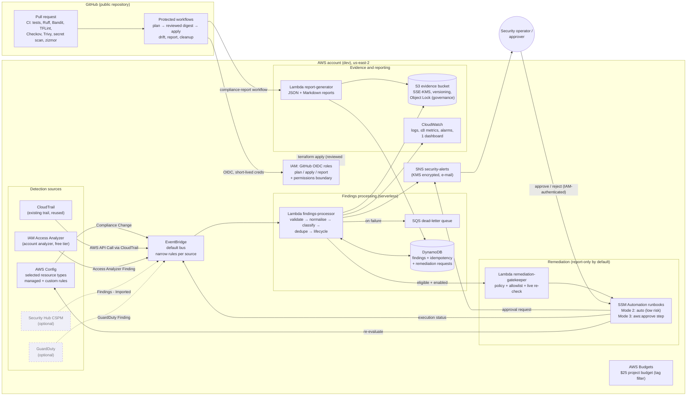

# Automated Cloud Security, Compliance & Governance (ACSCG)

An event-driven AWS platform that continuously evaluates resource configurations against a security
control catalog, normalises and de-duplicates findings, notifies operators, remediates **only**
explicitly authorised low-risk issues (or higher-risk ones after human approval), verifies the fix,
and keeps checksummed audit evidence mapped to NIST SP 800-53 Rev. 5, the CIS AWS Foundations
Benchmark, PCI DSS v4.0.1 and SOC 2.

> **Current status: Phase 1 (design) complete, awaiting approval.** Nothing is deployed to AWS.
> Status vocabulary: 📝 planned · 🧱 implemented · ✅ tested offline · ☁️ verified in AWS (ADR 0001).
>
> This is a **framework-aligned** portfolio project. It is not certified, attested or "compliant"
> with any framework.

## The lifecycle it automates

**Detect → Analyse → Approve → Remediate → Verify → Audit**

<!-- diagram:architecture -->

<!-- /diagram -->

## Security controls

<!-- generated:control-summary -->
| ID | Control | Severity | Detection | Remediation | Approval | Status |
|---|---|---|---|---|---|---|
| SEC-001 | S3 public access protection | high | config_managed_rule: S3_BUCKET_LEVEL_PUBLIC_ACCESS_PROHIBITED, S3_ACCOUNT_LEVEL_PUBLIC_ACCESS_BLOCKS_PERIODIC, S3_BUCKET_PUBLIC_READ_PROHIBITED, S3_BUCKET_PUBLIC_WRITE_PROHIBITED | Mode 2 (auto, allowlisted) | no | planned |
| SEC-002 | S3 default encryption | medium | config_managed_rule: S3_BUCKET_SERVER_SIDE_ENCRYPTION_ENABLED, S3_DEFAULT_ENCRYPTION_KMS | Report only | no | planned |
| SEC-003 | S3 versioning | low | config_managed_rule: S3_BUCKET_VERSIONING_ENABLED | Report only | no | planned |
| SEC-004 | S3 HTTPS-only access | medium | config_managed_rule: S3_BUCKET_SSL_REQUESTS_ONLY | Report only | no | planned |
| SEC-005 | Unrestricted SSH ingress | high | config_managed_rule: INCOMING_SSH_DISABLED | Mode 3 (human approval) | required | planned |
| SEC-006 | Unrestricted RDP ingress | high | config_managed_rule: RESTRICTED_INCOMING_TRAFFIC | Mode 3 (human approval) | required | planned |
| SEC-007 | Unencrypted EBS volumes | medium | config_managed_rule: ENCRYPTED_VOLUMES, EC2_EBS_ENCRYPTION_BY_DEFAULT | Report only | no | planned |
| SEC-008 | EC2 IMDSv2 enforcement | medium | config_managed_rule: EC2_IMDSV2_CHECK | Mode 3 (human approval) | required | planned |
| SEC-009 | IAM users without MFA | high | config_managed_rule: MFA_ENABLED_FOR_IAM_CONSOLE_ACCESS, IAM_USER_MFA_ENABLED | Report only | no | planned |
| SEC-010 | Excessively permissive IAM policies | high | config_managed_rule: IAM_POLICY_NO_STATEMENTS_WITH_ADMIN_ACCESS, IAM_POLICY_NO_STATEMENTS_WITH_FULL_ACCESS | Report only | no | planned |
| SEC-011 | Long-lived IAM access keys | medium | config_managed_rule: ACCESS_KEYS_ROTATED, IAM_USER_UNUSED_CREDENTIALS_CHECK | Report only | no | planned |
| SEC-012 | CloudTrail logging status | critical | hybrid: CLOUD_TRAIL_ENABLED, MULTI_REGION_CLOUD_TRAIL_ENABLED, CLOUD_TRAIL_LOG_FILE_VALIDATION_ENABLED, CLOUD_TRAIL_ENCRYPTION_ENABLED + CloudTrail→EventBridge | Escalate (never remediated) | no | planned |
| SEC-013 | Required resource tags | low | config_managed_rule: REQUIRED_TAGS | Mode 2 (auto, allowlisted) | no | planned |
| SEC-014 | CloudWatch log retention | low | config_managed_rule: CW_LOGGROUP_RETENTION_PERIOD_CHECK | Mode 2 (auto, allowlisted) | no | planned |
| SEC-015 | Unauthorized configuration changes | high | cloudtrail_eventbridge: CloudTrail→EventBridge | Report only | no | planned |
<!-- /generated -->

Framework mappings, versions, sources and the verification log are in
[docs/compliance-mapping.md](docs/compliance-mapping.md).

## Key design decisions

| Decision | Why |
|---|---|
| Report-only by default. Remediation needs an enable flag, an exact-ARN allowlist, a live re-check and (for higher risk) an authenticated SSM approval. Tags never authorise ([ADR 0006](docs/adr/0006-remediation-modes-and-authorization.md)) | Safe automation that cannot be turned into a confused deputy |
| Integrate with existing Config/CloudTrail/Security Hub/GuardDuty, never take ownership ([ADR 0003](docs/adr/0003-integrate-not-own-account-security-services.md)) | Cleanup can never disable pre-existing security monitoring |
| Config + CloudTrail as the primary path. Security Hub CSPM and GuardDuty optional and off by default ([ADR 0004](docs/adr/0004-config-primary-optional-securityhub-guardduty.md)) | Works without paid account-wide services |
| Evidence in KMS-encrypted, versioned, Object-Lock (governance) S3 with SHA-256 checksums ([ADR 0007](docs/adr/0007-evidence-store.md)) | Tamper-evident audit trail that can still be cleaned up |
| Apply only the reviewed plan (digest-bound, fail closed) ([ADR 0008](docs/adr/0008-plan-integrity.md)) | No TOCTOU between review and apply |
| Serverless Python 3.13. No EC2/ECS/EKS/RDS/ALB/NAT ([ADR 0010](docs/adr/0010-serverless-python-313.md)) | Near-zero idle cost |

## Documentation

| Document | Contents |
|---|---|
| [docs/phase-0-assessment.md](docs/phase-0-assessment.md) | Repository and AWS environment assessment, discovery checklist |
| [docs/architecture.md](docs/architecture.md) | Architecture, event flow, trust boundaries, data model, environments, Terraform module design |
| [docs/security-model.md](docs/security-model.md) | IAM roles, permissions boundary, remediation authorization and approval |
| [docs/threat-model.md](docs/threat-model.md) | STRIDE threats per trust boundary and mitigations |
| [docs/compliance-mapping.md](docs/compliance-mapping.md) | Control catalog, framework matrix, verification log |
| [docs/cost-model.md](docs/cost-model.md) | Unit prices (AWS Price List), assumptions, daily/monthly/demo estimates |
| [docs/cicd-design.md](docs/cicd-design.md) | Workflows, OIDC, plan integrity, repository governance |
| [docs/validation-scenarios.md](docs/validation-scenarios.md) | The 17 validation scenarios |
| [docs/roadmap.md](docs/roadmap.md) | Phase plan, exit criteria, Phase 2 task list |
| [docs/bootstrap-runbook.md](docs/bootstrap-runbook.md) | Read-only discovery (now) and bootstrap (Phase 3) |
| [docs/remediation-runbook.md](docs/remediation-runbook.md) | Operator procedures: windows, approvals, rollback, exceptions |
| [docs/portfolio-evidence.md](docs/portfolio-evidence.md) | Evidence log with run IDs and timestamps |
| [docs/adr/](docs/adr/README.md) | Architecture Decision Records |

## Repository layout

```
controls/        control catalog, schema, framework reference files (NIST, CIS v5/v6, PCI DSS, SOC 2)
diagrams/        Mermaid sources (embedded into docs by scripts/sync_diagrams.py)
docs/            design documentation and ADRs
policies/        remediation and exception policy drafts (schemas in Phase 2)
scripts/         discovery (read-only), catalog validation, doc generators
src/             Python 3.13 packages (Phase 2+)
terraform/       bootstrap, modules, envs (Phase 2+)
runbooks/        SSM Automation documents (Phase 2/6)
tests/           unit, integration, terraform, security tests
```

## Local checks

```bash
python3 -m pip install -r requirements-dev.txt
```

```bash
make check
```

`make check` validates the control catalog, runs the tests, checks Ruff, and verifies that the
generated documentation sections are current. No AWS credentials are needed.

## Related projects

1. [AWS-Cloud-Operations-AI-Automation](https://github.com/oteyami2001/AWS-Cloud-Operations-AI-Automation): incident detection, controlled remediation, recovery.
2. [Internal-Developer-Platform-CI-CD-Automation](https://github.com/oteyami2001/Internal-Developer-Platform-CI-CD-Automation): OIDC, protected environments, digest-bound apply, drift detection, verified cleanup.
