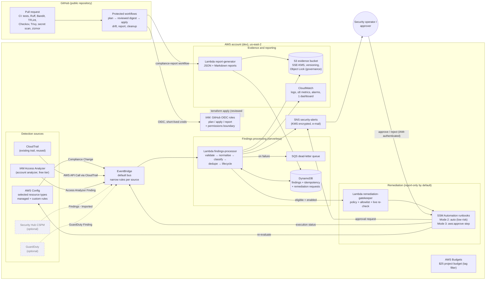
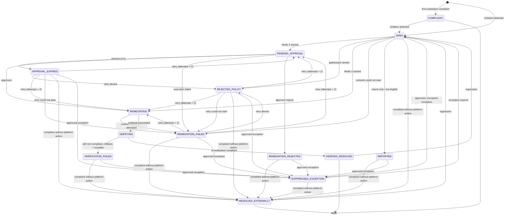
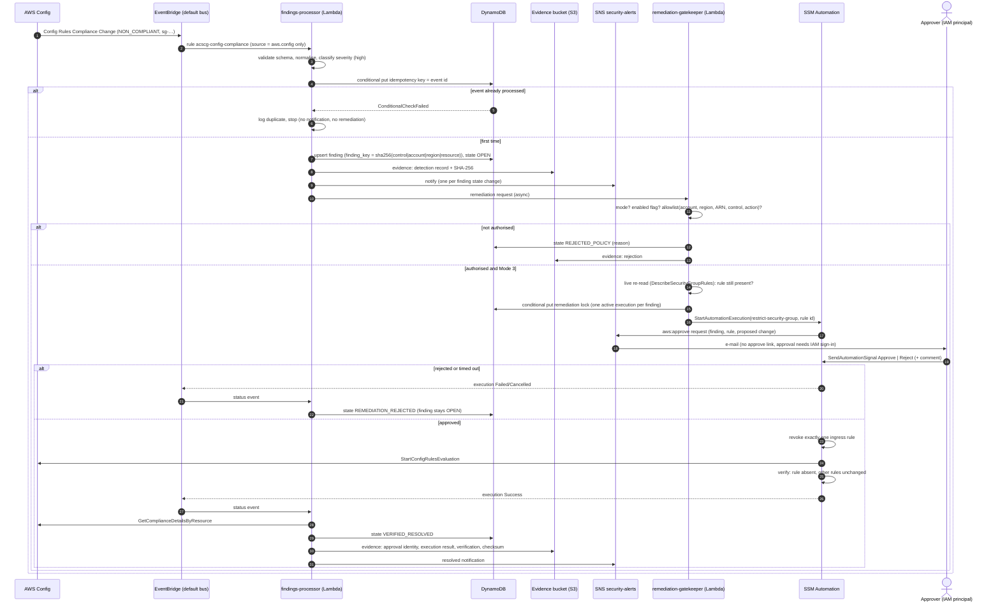
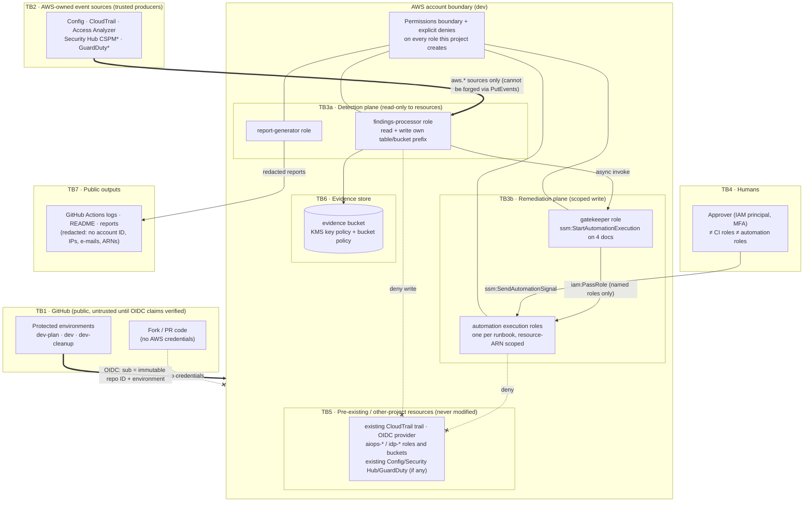

# Architecture

**Status: Phase 2. Every component below is implemented as code and tested offline (🧱/✅). Nothing is deployed (☁️ starts in Phase 3).** Status vocabulary (ADR 0001):
📝 planned · 🧱 implemented · ✅ tested offline · ☁️ verified in AWS.

## 1. Purpose

ACSCG continuously answers four questions for an AWS account:

1. Is the infrastructure secure? (continuous evaluation against the control catalog)
2. Are resources compliant with policy? (Config rules + custom evaluators → normalised findings)
3. What happens when a violation is found? (classify → notify → report, or remediate under policy)
4. Can we prove it was resolved? (verified re-evaluation + checksummed evidence + reports)

## 2. Design principles

| # | Principle | Consequence |
|---|---|---|
| P1 | **Integrate, never take over**, account-level security services | Each of Config, CloudTrail, Security Hub CSPM, GuardDuty and Access Analyzer has an `ownership_mode` of `create`, `integrate` or `disabled` (ADR 0003). Cleanup never disables a service this project did not create |
| P2 | **Report-only by default** | `remediation_mode = "report_only"` in every environment. Remediation also needs an enable flag **and** an allowlist entry (ADR 0006) |
| P3 | **Never trust the event** | The gatekeeper re-reads the live resource before acting. Tags inform decisions but never authorise them |
| P4 | **Serverless and event-driven** | No EC2, ECS, EKS, RDS, ALB or NAT Gateway. Idle cost is near zero |
| P5 | **Evidence is separate from operations** | Operational logs go to CloudWatch Logs (short retention). Audit evidence goes to a dedicated, KMS-encrypted, versioned, Object-Lock bucket |
| P6 | **Public-repository hygiene** | No account IDs, IPs, e-mails or plan files in Git or in CI logs |
| P7 | **Cost-conscious by construction** | Config records only the resource types the catalog needs. Optional paid services are off. Demonstrations run in short windows |

## 3. Target architecture

<!-- diagram:architecture -->

<!-- /diagram -->

### 3.1 Components

| Component | AWS service | Responsibility | Owned by this project? | Status |
|---|---|---|---|---|
| Configuration evaluation | AWS Config | Records selected resource types and evaluates managed and custom rules (SEC-001…014) | Rules: yes. Recorder: **`create` in dev** (D5: none existed) | 📝 |
| API audit source | CloudTrail | Management events for SEC-012/015 through EventBridge | **No.** Reuses the existing trail (ADR 0005) | 📝 |
| Access analysis | IAM Access Analyzer | External-access findings (SEC-001, SEC-010) | **SCP-denied in the target account (D8)**: off. Optional elsewhere | 📝 |
| Central findings (optional) | Security Hub CSPM | Additional controls and findings in ASFF | **SCP-denied in the target account (D6)**: `disabled` | 📝 |
| Threat detection (optional) | GuardDuty | Threat findings, report-only (scenario 16 offline) | **SCP-denied in the target account (D7)**: `disabled` | 📝 |
| Routing | EventBridge (default bus) | One narrow rule per source and detail-type | Yes | 📝 |
| Processing | Lambda `findings-processor` (Python 3.13, arm64) | Validation, normalisation, severity, ownership, dedupe, lifecycle, evidence, notification | Yes | 📝 |
| Dead letters | SQS `findings-dlq` (SSE-SQS) | Events that failed after retries (EventBridge target DLQ and Lambda on-failure destination) | Yes | 📝 |
| State | DynamoDB (on-demand, PITR on in prod) | Findings, idempotency keys (TTL), remediation requests, exceptions | Yes | 📝 |
| Remediation gate | Lambda `remediation-gatekeeper` | Policy decision: mode, flag, allowlist, account/Region/ARN/action, live re-check, lock | Yes | 📝 |
| Remediation execution | SSM Automation documents | Scoped actions. `aws:approve` step for Mode 3. Built-in verification step | Yes | 📝 |
| Evidence | S3 + KMS customer managed key | Encrypted, versioned, Object Lock (governance mode), restrictive policy | Yes | 📝 |
| Reporting | Lambda `report-generator` + GitHub workflow | JSON + Markdown reports, posture metrics | Yes | 📝 |
| Notification | SNS `security-alerts` (KMS) | Operator e-mail, approval requests | Yes | 📝 |
| Observability | CloudWatch | Logs, ≤8 custom metrics, alarms (DLQ depth, errors), one dashboard | Yes | 📝 |
| Cost guardrail | AWS Budgets | USD 25 budget filtered on `Project=acscg` (alert, **not** a cap) | Yes | 📝 |
| CI/CD identity | IAM + GitHub OIDC | plan / apply / report / cleanup roles, permissions boundary | Roles yes. OIDC provider: lookup | 📝 |

### 3.2 Event sources and EventBridge rules

| Rule | `source` | `detail-type` | Filter | Controls |
|---|---|---|---|---|
| `acscg-config-compliance` | `aws.config` | `Config Rules Compliance Change` | `configRuleName` prefix `acscg-` | SEC-001…014 |
| `acscg-cloudtrail-changes` | `aws.ec2`, `aws.s3`, `aws.cloudtrail`, `aws.config` | `AWS API Call via CloudTrail` | `eventName` in the SEC-012/015 lists | SEC-012, SEC-015 |
| `acscg-access-analyzer` | `aws.access-analyzer` | `Access Analyzer Finding` | status ACTIVE | SEC-001, SEC-010 |
| `acscg-ssm-status` | `aws.ssm` | `EC2 Automation Execution Status-change Notification` | document name prefix `acscg-` | lifecycle |
| `acscg-securityhub` *(optional)* | `aws.securityhub` | `Security Hub Findings - Imported` | product ≠ Config (Config is ingested directly), workflow NEW | optional |
| `acscg-guardduty` *(optional)* | `aws.guardduty` | `GuardDuty Finding` | severity ≥ 4 | scenario 16 |

`aws.*` sources cannot be sent with `PutEvents` by account principals. A forged "Config" event
therefore cannot enter through these rules. Synthetic test events use the source
`acscg.synthetic`. The `acscg-synthetic` rule exists only when `allow_synthetic_events = true`
(dev), and the processor **never** sends a synthetic finding to remediation.

**Duplicate path:** with Security Hub enabled, a Config evaluation arrives twice (directly and as
an ASFF finding). The Security Hub rule excludes Config-generated findings. The canonical
`finding_key` also merges duplicates (§4.3).

## 4. Findings processing engine

### 4.1 Pipeline

```
event → (1) schema validation → (2) normalisation → (3) severity classification
      → (4) ownership validation → (5) idempotency check → (6) lifecycle upsert
      → (7) evidence write → (8) notification (state changes only) → (9) remediation request (if eligible)
```

| Step | Behaviour | Failure handling |
|---|---|---|
| 1 Validation | JSON Schema per source and detail-type (`src/findings_processor/schemas/`). Unknown shape → rejected | Logged as `invalid_event`, sent to the DLQ, never retried |
| 2 Normalisation | One internal `Finding` model: `finding_key`, `control_id`, `source`, `resource{type,id,arn,account,region}`, `compliance`, `observed_at`, `raw_ref` | Pure function, unit-tested per source |
| 3 Severity | Catalog base severity → escalation rules (e.g. SEC-001 actual public grant → critical). Source severity (GuardDuty/ASFF) mapped to the same 5 levels | Deterministic table test |
| 4 Ownership | Resource classified as `project-owned` (on the allowlist **and** in this project's state inventory), `pre-existing` (protected list) or `unknown`. Only `project-owned` resources can ever be remediated | `unknown` → report only |
| 5 Idempotency | `PutItem` with `attribute_not_exists(pk)` on `EVENT#<event id>` (TTL 7 days) | Duplicate → stop silently (scenario 6) |
| 6 Lifecycle | Conditional `UpdateItem` on `FINDING#<finding_key>` with a `version` attribute (optimistic locking). States as in §4.4 | Version conflict → re-read, retry up to 3 times |
| 7 Evidence | `evidence/<control>/<finding_key>/<ts>-<event>.json` + SHA-256 in the object metadata and in DynamoDB | Retry with backoff. Failure → finding marked `evidence_pending`, alarm |
| 8 Notification | SNS only on state change (OPEN, PENDING_APPROVAL, VERIFIED_RESOLVED, failures) | Notification de-duplicated by `(finding_key, state)` |
| 9 Remediation request | Async invoke of the gatekeeper with the finding key only (the gatekeeper re-reads everything) | Lambda async retries = 0. The gatekeeper itself is idempotent through a lock item |

Lambda settings: reserved concurrency 5 (caps cost and API pressure during event storms),
timeout 30 s, EventBridge retry policy 2 attempts / 1 h max age, then the DLQ. Logs are structured
JSON with `finding_key`, `control_id` and `correlation_id`. Account IDs are masked in log messages.

### 4.2 Data model (single table `acscg-<env>-findings`)

| Item | `pk` | `sk` | Key attributes |
|---|---|---|---|
| Idempotency | `EVENT#<source event id>` | `EVENT` | `ttl` (7 days) |
| Finding | `FINDING#<finding_key>` | `STATE` | `control_id`, `severity`, `state`, `version`, `first_seen`, `last_seen`, `resource_*`, `evidence_keys[]` |
| History | `FINDING#<finding_key>` | `HIST#<ts>#<state>` | transition, actor, reason |
| Remediation | `FINDING#<finding_key>` | `REM#<request id>` | mode, action, `execution_id`, `approver_arn`, `decision`, timestamps, result |
| Lock | `LOCK#<finding_key>` | `LOCK` | `execution_id`, `ttl` (one active remediation per finding) |
| Exception | `EXC#<control_id>` | `<resource arn hash>` | approver, reason, `expires_at` (≤ 90 days), ticket |

GSI `by-control-state` (`control_id`, `state`) for reports. `finding_key =
sha256(control_id | account | region | resource_arn)`, so the same violation from Config, Security
Hub or a re-evaluation always maps to one finding.

### 4.3 Remediation authorization (summary, full design in `docs/security-model.md`)

A remediation runs only if **all** of these hold. Each one is checked by code and recorded:

1. The environment has `remediation_mode` ∈ {`auto_low_risk`, `human_approval`} **and** `remediation_enabled = true`.
2. The control's catalog eligibility allows the requested mode.
3. An allowlist entry (Terraform-managed, `policies/remediation/allowlist.<env>.yaml`) matches
   **account, Region, exact resource ARN, control ID and action**, and has not expired.
4. The resource is `project-owned` and not on the protected list.
5. A live re-read confirms the violation still exists and matches the finding.
6. No other remediation lock exists for the finding. Fewer than 3 attempts have been made.
7. Mode 3 only: an approver from the approver list sends `Approve` before the timeout.
8. IAM independently limits the execution role to the allowlisted ARNs (defence in depth).

### 4.4 Lifecycle

<!-- diagram:remediation-flow -->

<!-- /diagram -->

## 5. Security event flow

<!-- diagram:security-event-flow -->

<!-- /diagram -->

## 6. Trust boundaries

<!-- diagram:trust-boundaries -->

<!-- /diagram -->

Each boundary's threats and mitigations are in `docs/threat-model.md`.

## 7. Evidence storage

| Property | Design |
|---|---|
| Bucket | `acscg-<env>-evidence-<account>-<region>` (name built in Terraform, never committed) |
| Encryption | SSE-KMS with a project customer managed key and an S3 Bucket Key. The key policy allows decrypt only to the processor, report and auditor roles |
| Integrity | SHA-256 of each evidence document stored in S3 object metadata and DynamoDB. A daily manifest lists keys + hashes, and the manifest itself is hashed into the next report |
| Immutability | Versioning + **Object Lock in governance mode** (dev: 7-day default retention; prod reference: 365 days). Governance mode is chosen so that verified cleanup stays possible with a separately approved `s3:BypassGovernanceRetention` (ADR 0007). The evidence is therefore **tamper-evident, not tamper-proof** |
| Access | Bucket policy: deny non-TLS, deny PutObject without KMS, deny delete for every principal except the cleanup role, deny all writes outside the writer roles' prefixes |
| Separation | `evidence/` (findings, approvals, executions), `reports/` (generated reports), `manifests/`. Operational logs live in CloudWatch Logs, never in this bucket |
| Retention | Lifecycle: current versions kept for the Object Lock period + 30 days in dev. Noncurrent versions expire after 30 days |

Evidence record fields (prompt §12): finding ID, control ID, resource identity, detection
timestamp, previous compliance state, proposed remediation, approval identity and timestamp,
execution result, updated compliance state, verification timestamp, SHA-256 checksum.

## 8. Environment strategy

| Setting | dev (deployed first) | staging (reference) | prod (reference) |
|---|---|---|---|
| Deployed in this project | Yes (Phase 4+) | **No**: validated by `terraform validate`/tests only | **No**: validated only |
| Region | us-east-2 (pending D2) | us-east-2 | us-east-2 |
| `remediation_mode` | `report_only` (default). Switched to `human_approval` / `auto_low_risk` only for approved demo windows | `report_only` | `report_only` (any change requires an ADR) |
| `remediation_enabled` | `false` by default | `false` | `false` |
| Allowlist | Project test resources only | empty | empty |
| `allow_synthetic_events` | `true` | `false` | `false` |
| Config ownership | per D5 | `integrate` | `integrate` |
| Security Hub CSPM / GuardDuty | `disabled` (enabled only in an approved window) | `disabled` | `integrate` |
| Log retention (project groups) | 30 days | 90 days | 365 days |
| Evidence Object Lock default | 7 days (governance) | 30 days (governance) | 365 days (governance; compliance mode is an organisational decision) |
| DynamoDB PITR | off | on | on |
| GitHub environments | `dev-plan`, `dev`, `dev-cleanup` | `staging-plan`, `staging` | `prod-plan`, `prod` (2 reviewers) |

No new AWS accounts are created and no organization policies are modified. The Enterprise Landing
Zone project stays separate.

## 9. Terraform module design (🧱 implemented, ✅ `terraform test`)

```
terraform/
├── bootstrap/                 # once per account, from CloudShell (Phase 3): local → S3 state migration
│   ├── state.tf               # acscg-tfstate-<acct>-<region>: SSE-KMS, versioning, TLS-only, native locking (use_lockfile)
│   ├── ci_roles.tf            # <env>-plan / <env>-apply / <env>-cleanup + report roles (immutable OIDC subjects)
│   ├── boundary.tf            # acscg-workload-boundary: project data only, explicit denies (security-model §2)
│   └── tests/                 # policy sizes, trust subjects, boundary-only role creation, region guard
├── modules/                   # 12 modules, each with tests/*.tftest.hcl (mock providers)
│   ├── iam-oidc  security-config  security-hub  guardduty  cloudtrail  eventbridge
│   └── compliance-engine  remediation  evidence-store  notifications  dashboard  budgets
├── stack/                     # ONE root for all environments (ADR 0012) + isolated test fixtures
│   └── tests/                 # stack.tftest.hcl (scenarios) + environments.tftest.hcl (per-env invariants)
└── envs/{dev,staging,prod}/   # terraform.tfvars + backend.hcl.example only
```

Module conventions (as implemented):

- `required_version >= 1.10` (native S3 locking), AWS provider `~> 6.73` (tested with 6.73.0).
  Root lock files are generated in Phase 3 (registry access).
- The account is enforced by `allowed_account_ids` plus a `check` block. Region allowlist: `us-east-2`.
- `default_tags`: Project, Environment, ManagedBy, Owner, DataClassification, Repository.
- Safest defaults: `remediation_mode = report_only`, `remediation_enabled = false`, Security Hub
  and GuardDuty `disabled`, Config and CloudTrail `integrate`, synthetic events off, fixtures off.
- `integrate` mode creates nothing for the service (tested). The plan guard additionally rejects
  any change to those resource types unless the matching mode is `create`.
- Security-relevant policies (OIDC trust, runbook execution, gatekeeper, evidence bucket) are
  rendered with `jsonencode` so tests can assert their exact statements.
- Lambda: Python 3.13, arm64, reserved concurrency, X-Ray `Active`, CMK-encrypted environment,
  `Text` log format (the code writes masked JSON lines; ADR 0013), DLQ + bounded retries.
- DynamoDB PITR is on in every environment (the table is tiny). Deletion protection is on in prod.

## 10. Naming and tagging

`acscg-<env>-<component>` (e.g. `acscg-dev-findings-processor`). Config rules: `acscg-<control>-<short-name>`
(e.g. `acscg-sec005-restricted-ssh`), so the EventBridge filter can select this project's rules only.

## 11. Known limitations (design level)

| # | Limitation | Effect |
|---|---|---|
| L1 | Single Region (us-east-1 SCP-denied, to be confirmed) | IAM change events are not near-real time. CIS "all Regions" items unmet |
| L2 | Config rule evaluation latency | Change-triggered rules usually evaluate within minutes. Periodic rules (IAM) run every 24 h by default |
| L3 | Shared account | Another project's broad role could change ACSCG resources (T-14) |
| L4 | Governance-mode Object Lock | Privileged users can bypass retention. Evidence is tamper-evident, not tamper-proof |
| L5 | No EC2 instance in scope | SEC-007/008 live validation uses synthetic events unless an instance is approved |
| L6 | Framework mappings partly unverified against primary sources | See the verification log in `docs/compliance-mapping.md` |
| L7 | Security Hub CSPM / GuardDuty demonstrated only in short, approved windows | Scenario 16 uses GuardDuty sample findings |
